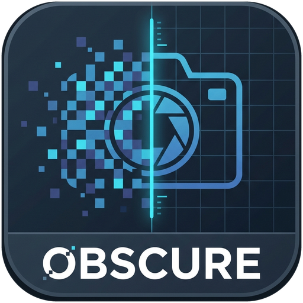
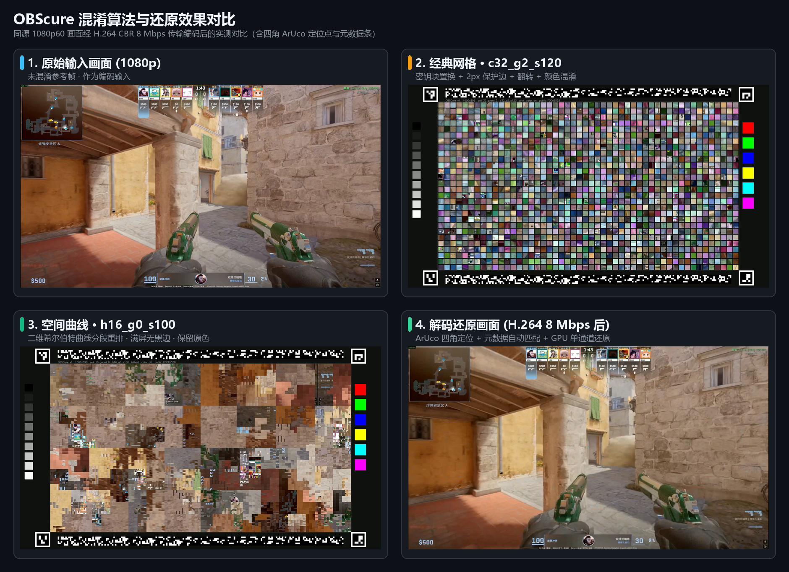
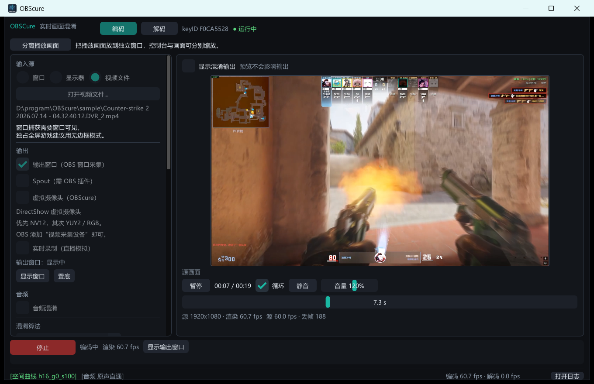
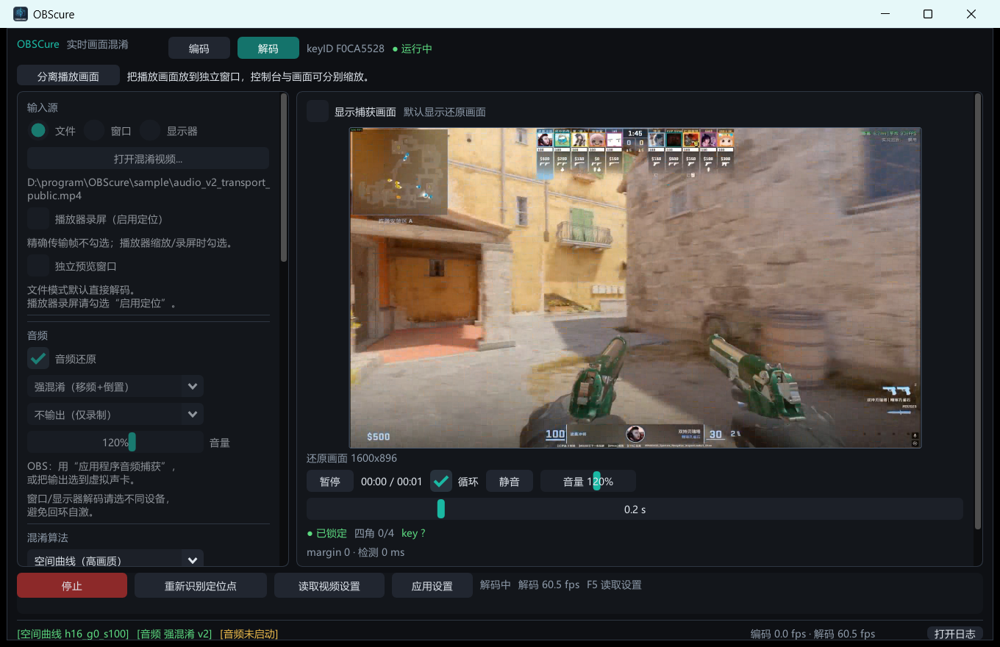
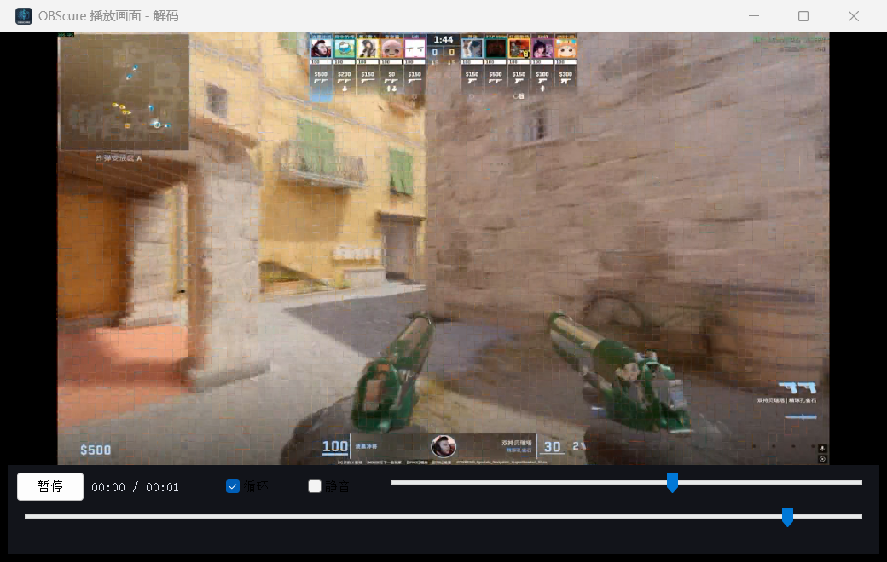
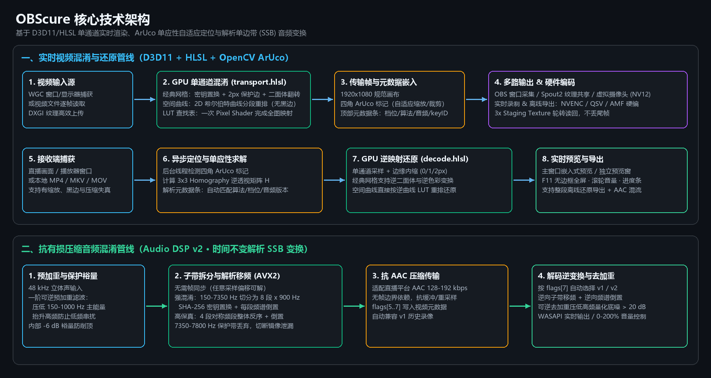

<div align="center">



# OBScure

**实时画面与音频混淆 / 还原工具 · 为直播推流与视频分享而生**

[](https://github.com)
[](https://github.com)
[-f59e0b?style=flat-square)](https://github.com)
[](https://github.com)
[](https://github.com)

*GPU 单通道实时重排 · 抗平台有损压缩 · 四角 ArUco 自适应定位 · 元数据零配置自动匹配*

</div>

---

## 项目简介

**OBScure** 是一款面向直播与视频传输场景的实时音视频混淆与还原桌面软件。编码端捕获游戏窗口、显示器或本地视频文件，在 GPU 上将画面重组为抗压缩的传输帧并同步混淆音频，直接推送给 **OBS Studio**（无插件输出窗口、Spout2 纹理共享或独立 DirectShow 虚拟摄像头）；接收端只需捕获播放器窗口、显示器或录屏文件，即可自动识别传输帧中的四角定位点与元数据，实时还原清晰画面与声音。

> **核心设计目标**：在直播平台常见的 **6–8 Mbps H.264 压缩**、**AAC 128–192 kbps 有损音频** 以及 **窗口缩放/黑边裁剪** 条件下，依然能稳定锁定并清晰还原。

---

## 核心特性

- **双视频混淆算法**
  - **经典网格（强混淆）**：密钥置换微块 + 1–2 px 保护边 + 二面体翻转 + 色彩通道/亮度混淆，抗静态观察与逆向分析能力最强。
  - **空间曲线（高画质）**：基于密钥生成二维 **希尔伯特空间填充曲线（Hilbert Curve）**，分段循环与重排微块；无黑边、块保持正立且保留原色，大幅降低视频编码器在块边界的码率损耗，**6–8 Mbps 直播下画质显著更清晰**。
- **抗 AAC 压缩音频混淆（Audio DSP v2）**
  - 时间不变的解析单边带（SSB）子带变换，**不依赖帧边界**，接收端从任意时刻接入都能立即还原。
  - 编码前可逆预加重 + `7350–7800 Hz` 保护带 + `-6 dB` 裕量，消除高频原声特征泄漏与解码底噪。
  - 支持 **强混淆（8 段 900 Hz 置换+倒置）**、**高保真（4 段对称镜像）** 与 **原声直通**，并自动兼容 v1 历史录像。
- **全自动元数据匹配**
  - 传输帧顶部与底部嵌入防错元数据条，编码算法、画质档位、公开/私有模式、颜色开关、音频算法与 DSP 版本随画面一起传输，解码端自动同步切换，无需手动对参数。
- **无密钥公开模式 & 私有密钥模式**
  - 既支持共享密钥（实时校验 `keyID`），也支持一键开启公开模式，让任何安装 OBScure 的观众直接观看还原画面。
- **GPU 硬件编码与多路输出**
  - 自动探测并优先启用 **NVIDIA NVENC / Intel QSV / AMD AMF** 硬件编码，支持 3 路轮转 Staging Texture 异步读回。
  - 支持 **MP4 / MKV / MOV（H.264 / H.265 / AV1）** 整段离线导出与实时录制模拟。

---

## 混淆算法与还原效果

下图展示了同一帧 `1080p60` 游戏画面分别经过 **经典网格（c32_g2_s120）** 与 **空间曲线（h16_g0_s100）** 处理，并经 **H.264 CBR 8 Mbps** 压缩后再还原的实测效果：

<div align="center">

</div>

| 对比维度 | 经典网格 (`c32_g2_s120`) | 空间曲线 (`h16_g0_s100`) |
|---|---|---|
| **空间变换** | 网格分块随机置换 + 二面体旋转/翻转 | 二维希尔伯特曲线分段循环偏移与重排 |
| **颜色混淆** | 可选开启（通道置换 / 反相） | 固定保留原色，维持局部色度连续 |
| **保护边** | 1–2 px 保护边隔离块间串色 | `guard = 0`，满屏无黑边 |
| **适用场景** | 隐私优先级最高、静态画面不可辨识 | 直播推流（6–8 Mbps）、动态高画质优先 |

---

## 界面预览

### 1. 编码控制台与实时预览
支持窗口（WGC）、显示器、视频文件拖放导入；左侧集中控制输入源、OBS 输出方式、音频策略、算法与离线导出，右侧实时对比源画面与传输帧。

<div align="center">

</div>

### 2. 解码还原与自动匹配
自动从传输帧读取四角 ArUco 定位点与元数据条，实时显示锁定状态、`keyID`、`margin` 与检测耗时；文件模式内置进度条、循环开关与 0–200% 音量控制。

<div align="center">

</div>

### 3. 独立播放窗口（分离模式）
按 `F9` 一键分离画面与控制台，主窗口收窄为侧边控制条；独立窗口支持 **`F8` 始终置顶**、**`F11` 无边框全屏**、**鼠标滚轮调节音量** 与底部快捷播放条。

<div align="center">

</div>

---

## 技术实现架构

<div align="center">

</div>

### 关键实现细节

1. **D3D11 单通道查找表（LUT）着色器渲染**
   - 无论经典网格还是希尔伯特空间曲线，密钥派生后都会预先生成映射查找表并上传至 GPU 常量/纹理缓冲。
   - `transport.hlsl` 与 `decode.hlsl` 在单个 Pixel Shader Pass 内完成坐标逆映射、二面体采样与边缘内缩（`0 / 1 / 2 px`），在 1080p60 下 GPU 耗时极低。
2. **后台异步 ArUco 单应性求解（Homography）**
   - 解码端在独立工作线程运行 OpenCV ArUco 四角标记检测，求得 `3×3` 透视变换矩阵 $H$ 后无缝更新到 GPU。即使播放器窗口被拖动缩放、存在黑边或轻微裁切，画面仍能自动对齐还原。
3. **带内元数据与容错校验**
   - 传输帧上下边条编码了 `version`、`preset_id`、`algorithm`、`key_id`、`audio_algorithm`、`audio_version` 等完整状态；解码端读取后自动配置视频与音频管线，避免人工参数不一致导致的解码失败。
4. **Audio DSP v2 解析单边带变换（AVX2 加速）**
   - 针对传统移频在 AAC 压缩后出现的高频底噪与低频能量搬移残留问题，v2 引入一阶可逆预加重/去加重滤波与 `7350–7800 Hz` 保护带：
     - 编码端先均衡各频段能量并保留 `-6 dB` 峰值裕量，再将 `150–7350 Hz` 拆分为 **8 段 × 900 Hz**（强混淆）或 **4 段对称频段**（高保真）进行密钥置换与频谱倒置；
     - 解码端执行逆向搬移后通过去加重滤波器将高频量化噪声压低 **20 dB 以上**，同时保持与旧版 v1 录像的向后兼容。
5. **多通道低开销采集与硬编输出**
   - 采集端采用 Windows Graphics Capture（WGC），支持窗口被遮挡状态下持续捕获；
   - 导出与实时录制采用 3 槽轮转 Staging Texture，使 GPU 拷贝与 CPU 读回/管道写入流水线并行，并自动探测 `NVENC` / `QSV` / `AMF` 硬件编码器以降低 CPU 占用。

---

## 快捷操作一览

| 操作 | 作用 |
|---|---|
| **拖放视频文件到窗口** | 自动设为当前页（编码/解码）源文件并读取参数 |
| **`F9`** | 切换合并模式 / 独立播放窗口 |
| **`F8`** | 独立播放窗口切换始终置顶 |
| **`F11` / `Esc`** | 独立播放窗口进入 / 退出无边框全屏 |
| **鼠标滚轮（独立窗口）** | 实时调节输出音量（0–200%） |
| **`Space` / `←` / `→`** | 播放暂停 / 后退 5 秒 / 前进 5 秒 |
| **`F5` / `F6`** | 解码运行中强制读取视频元数据 / 应用手动设置 |

---

## 典型使用流程

1. **主播 / 发送端**：打开 OBScure → 选择 **编码** → 选中目标游戏窗口或视频文件 → 勾选输出方式（**输出窗口 / Spout2 / 虚拟摄像头**，按需勾选音频混淆）→ 选择 **空间曲线 `h16_g0_s100`** → 在 OBS 中添加对应采集源并按 **6–8 Mbps CBR** 推流或录制。
2. **观众 / 接收端**：打开 OBScure → 选择 **解码** → 捕获直播/播放器窗口或直接打开传输视频文件 → 保持 **自动匹配视频设置** 开启 → 点击 **开始解码**，即刻还原清晰音画。

---

## 构建（开发者）

### 依赖

- Windows 10 / 11 x64，Visual Studio 2022 Build Tools（MSVC 19.4x）
- CMake ≥ 3.24 + Ninja
- OpenCV 4.10（含 contrib / aruco）静态库
- 仓库已内置 `third_party/imgui`、`third_party/Spout2`、`third_party/UnityCapture`

### 编译 OpenCV

`work/build_opencv.bat` 会构建 `core, imgproc, imgcodecs, calib3d, features2d, objdetect, aruco, videoio` 的静态库。脚本中的 VS / CMake 路径请按本机环境修改；也可以使用自行安装的 OpenCV 并通过 `-DOPENCV_ROOT=...` 指定。

### 编译项目

```bat
work\build_cli.bat
```

产物位于 `build\`：`obscure-gui.exe`、`obscure-vcam.dll`、`shaders\` 等。

`ffmpeg.exe` 与 `av*.dll` / `sw*.dll` 需要放在仓库根目录（构建时会自动部署着色器与虚拟摄像头 DLL）。

### 文档

- 使用说明：[docs/USAGE.md](docs/USAGE.md)
- 传输格式与元数据：[docs/transport-metadata.md](docs/transport-metadata.md)

---

## 许可证

OBScure 本体使用 **MIT License**，见 [LICENSE](LICENSE)。

第三方组件（Dear ImGui、Spout2、UnityCapture、OpenCV、FFmpeg）的许可与说明见
[THIRD_PARTY_NOTICES.txt](THIRD_PARTY_NOTICES.txt)。
发布压缩包内附带的 FFmpeg 二进制遵循 GPLv3，完整文本位于
[docs/licenses/FFMPEG-GPLv3.txt](docs/licenses/FFMPEG-GPLv3.txt)。


